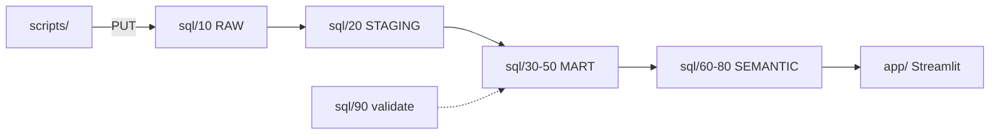

# agent_memento

Governed data product for voice AI agents on Snowflake.
- Turns 12.7 M Braintrust agent spans into a star schema with account economics.
- Serves 3 persona copilots (Agent PM, CSM, Finance) in Snowflake Intelligence and in Claude Desktop over MCP.
- Runs an autonomous supervisor that proposes actions, which humans approve in a Streamlit Action Inbox. Built for the Anthropic × Snowflake "Intelligence at Work" hackathon.

## Quick Navigation

- [Layout](#layout)
- [Build](#build)
- [Docs](#docs)

---

## Layout

| Path | Contents |
|---|---|
| [sql/](sql) | Numbered build scripts `00`–`90`, run in order |
| [scripts/upload_parquet.py](scripts/upload_parquet.py) | PUT local Parquet (`PARQUET_DIR`) to `@AGENT_MEMENTO.RAW.SPANS_STAGE` |
| [scripts/run_sql.py](scripts/run_sql.py) | Run SQL files through the Python connector (browser login) |
| [app/](app) | Streamlit dashboard and `snowflake.yml` |
| [docs/](docs) | Architecture, plan, tracker |

[Back to top](#quick-navigation)

---

## Build

1. Run [00_foundation.sql](sql/00_foundation.sql).
2. Run `python scripts/upload_parquet.py`, then [10_raw_load.sql](sql/10_raw_load.sql).
3. Run `20`, `30`, `35`, `40`, `50`, `55`, `60`, `65`, `70`, `75` and `80` in [sql/](sql), in that order.
   - `55` MUST follow any MART rebuild.
   - `65` includes the supervisor backfill.
4. Run [90_validate.sql](sql/90_validate.sql). Every check MUST return `PASS` (25 DQ checks plus 3 role checks).

Account `ANTHROPIC-SNOWFLAKE-HACKATHON-ASDZAA`, role `ATTENDEE_ROLE`, warehouse `DEFAULT_WH`.

[Back to top](#quick-navigation)

---

## Docs

- [Architecture](docs/Architecture.md): data flow, star schema, rules, governance
- [Project Plan](docs/Project-Plan.md): outcomes, phases, decisions, next steps
- [Tracker](docs/Tracker.md): item status, DQ results, risks
- [Demo Runbook](docs/Demo-Runbook.md): 5-minute demo and Claude Desktop setup
- [Phase 2 spec](docs/superpowers/specs/2026-10-23-persona-copilots-supervisor-design.md): persona copilots, supervisor, trust layer

[Back to top](#quick-navigation)
