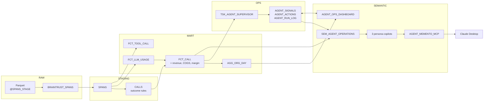
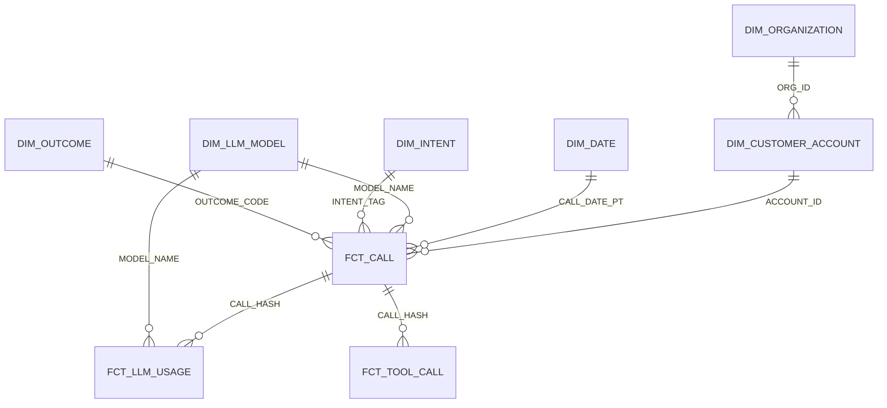
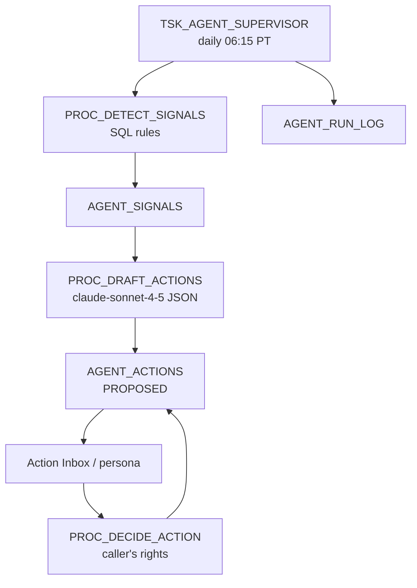

# Agent Memento: Architecture

Governed data product for voice AI agents on Snowflake. It turns 12.7 M Braintrust agent spans into a star schema with account economics, then serves it to three persona copilots, Claude Desktop over MCP, and a Streamlit console. An autonomous supervisor proposes actions on the same data and logs every human decision.

## Quick Navigation

- [Overview](#overview)
- [Data Flow](#data-flow)
- [Star Schema](#star-schema)
- [Key Rules](#key-rules)
- [Trust](#trust)
- [Autonomy](#autonomy)
- [Consumers](#consumers)
- [Objects](#objects)
- [Known Limits](#known-limits)

---

## Overview

| Item | Value |
|---|---|
| Source | 63 Parquet files (8.4 GB), `event_dt` 2026-07-29 to 2026-09-01, synthetic Braintrust spans |
| Volume | 12,698,693 spans, 243,036 calls, 5.15 M billable minutes, 30.7 B tokens |
| Economics | Revenue $274.6 K, COGS $159.3 K (model $115.5 K + telephony $43.8 K), gross margin 42.0% |
| Quality | 97.0% resolution, 3.0% failure, 2.97% tool error rate |
| Supervisor | 36 proposals over 5 weeks; latest week's monthly impact $29.7 K |
| Account | `ANTHROPIC-SNOWFLAKE-HACKATHON-ASDZAA`, warehouse `DEFAULT_WH` (MEDIUM), database `AGENT_MEMENTO` |
| Design spec | [Phase 2 spec](superpowers/specs/2026-10-23-persona-copilots-supervisor-design.md) |

[Back to top](#quick-navigation)

---

## Data Flow

| Schema | Responsibility |
|---|---|
| `RAW` | Land files unchanged; JSON text parsed to `VARIANT` |
| `STAGING` | Type, stitch spans into calls, outcome rules; transient |
| `MART` | Dimensions, facts and the aggregate; hashes only |
| `OPS` | Supervisor signals, actions, run log, eval results |
| `SEMANTIC` | Semantic view, agents, MCP server, Streamlit |
| `GOVERNANCE` | Tags, masking and row access policies, access map |

[Back to top](#quick-navigation)

---

## Star Schema

| Table | Grain | Rows | Key measures |
|---|---|---|---|
| `FCT_CALL` | Call (`CALL_HASH`) | 243,036 | Duration, counts, tokens, model cost, billable minutes, revenue, telephony, COGS, gross margin, outcome, intent, anomaly flags |
| `FCT_LLM_USAGE` | LLM span | 6,223,558 | Model, tokens, cost, latency, error |
| `FCT_TOOL_CALL` | Tool span | 6,230,879 | `TOOL_SEQ_NO`, latency, error |
| `AGG_ORG_DAY` | Date × account × model × intent × outcome | — | Additive sums only |
| `DIM_CUSTOMER_ACCOUNT` | Account (8) | 8 | Segment, CSM owner, plan, contract price per minute |
| `DIM_ORGANIZATION` | Org (from real `ORG_ID`) | 1 | Org and project |
| `DIM_LLM_MODEL`, `DIM_COST_RATE` | Model, single row | 4, 1 | Token prices, telephony rate |
| `DIM_DATE`, `DIM_INTENT`, `DIM_OUTCOME`, `DIM_SPAN_TYPE` | Natural keys | 366, 6, 5, 4 | Calendar, intent, outcome flags |

[Back to top](#quick-navigation)

---

## Key Rules

- **Call key:** `ROOT_SPAN_ID`, hashed by `GOVERNANCE.FN_CALL_HASH`. `metadata.session_id` is unique per span, so it isn't used as a call key.
- **Account:** each call is assigned by `MART.FN_ACCOUNT_BUCKET(CALL_HASH)`, a stable 0–99 bucket, against `BUCKET_LO`/`BUCKET_HI` volume shares. Accounts are synthetic.
- **Economics:**
  - `BILLABLE_MINUTES` = `CEIL(duration / 60)`.
  - Revenue = minutes × contract price.
  - COGS = model cost + minutes × $0.0085 telephony.
  - Margin = revenue − COGS.
- **Model cost:** tokens and cost come from `llm` spans priced by `DIM_LLM_MODEL`. Cost by model MUST be read at LLM-span grain.
- **Outcome**, in order: `INCOMPLETE` (no root) → `FAILED` (root error) → `RECOVERED` (child error) → `RESOLVED_LOW_QUALITY` (score < 0.3) → `RESOLVED`.
- **Anomaly:** cost or duration more than 3 sd above the trailing 7-day mean.

[Back to top](#quick-navigation)

---

## Trust

| Persona | Role | Rows | Revenue / margin / price |
|---|---|---|---|
| Agent Product Manager | `AM_AGENT_PM_R` | All 8 accounts | Masked |
| Customer Success Manager | `AM_CSM_R` | 3 accounts (Priya Shah's book) | Masked |
| Finance (COGS) | `AM_FINANCE_R` | All 8 accounts | Clear |

| Control | Applied to |
|---|---|
| `RAP_ACCOUNT` (row access via `ACCOUNT_ACCESS_MAP`) | `FCT_CALL`, `FCT_LLM_USAGE`, `FCT_TOOL_CALL`, `AGG_ORG_DAY`, `DIM_CUSTOMER_ACCOUNT` |
| `MP_FINANCIAL`, `MP_FINANCIAL_PRICE` | Revenue, gross margin, contract price |
| `MP_FREE_TEXT_VARIANT`, `MP_IDENTIFIER`, `MP_EMAIL`, `MP_FREE_TEXT` + PHI/PII tags | RAW and STAGING payloads, session id, user name, email, error text |
| `HIPAA_DATA_TIER` | Facts `IDENTIFIED`, `AGG_ORG_DAY` `DEIDENTIFIED` |
| Agents run as the caller | The same question returns different rows and columns per persona (verified: RL01–RL03) |
| Supervisor prompt | Aggregates only; strict JSON schema; numbers computed in SQL |

[Back to top](#quick-navigation)

---

## Autonomy

| Signal | Rule (7 days ending as-of) | Owner | Fired (5 weeks) |
|---|---|---|---|
| `NEGATIVE_MARGIN_ACCOUNT` | Account gross margin < 0 | Finance | 9 (Fabrikam, Litware, Proseware) |
| `MODEL_COST_SHIFT` | Premium share of an intent's LLM cost > 40% and savings ≥ $100/month | Agent PM | 25 |
| `ANOMALY_SPIKE` | Account rate > 1.5× prior and > 1.2× the platform change; else one platform signal | CSM / Agent PM | 2 (platform) |
| `FAILURE_SPIKE` | Account rate > 1.3× prior and > 1.2× the platform change | Agent PM | 0 |

**Rules:**
- **Idempotent:** a rerun for the same as-of date adds 0 rows (verified).
- **Projected impact** is a monthly run rate computed in SQL. Claude writes only the title, diagnosis and recommendation.
- **AI failure:** if the model call fails, the action is still written with `DRAFT_STATUS = AI_FAILED` and SQL evidence as its text.

[Back to top](#quick-navigation)

---

## Consumers

| Surface | Object | Notes |
|---|---|---|
| Snowflake Intelligence | `AGENT_PM_COPILOT`, `CSM_COPILOT`, `FINANCE_COGS_COPILOT` | Persona instructions and sample questions; 15 VQRs in the semantic view |
| Claude Desktop | `AGENT_MEMENTO_MCP` | 3 agent tools + Cortex Analyst tool; see [Demo Runbook](Demo-Runbook.md) |
| Streamlit | `AGENT_OPS_DASHBOARD` | Overview, Accounts, Action Inbox. Runs as its owner role; the persona selector applies the persona view in the app |
| SQL | `SEM_AGENT_OPERATIONS` | 10 logical tables, margin and action metrics |

[Back to top](#quick-navigation)

---

## Objects

| Script | Builds |
|---|---|
| [00_foundation.sql](../sql/00_foundation.sql) | Schemas, analyst role, tags, PHI masking, `FN_CALL_HASH` |
| [10_raw_load.sql](../sql/10_raw_load.sql) | Stage, file format, `RAW.BRAINTRUST_SPANS` |
| [20_staging.sql](../sql/20_staging.sql) | `STAGING.SPANS`, `STAGING.CALLS` |
| [30_dims.sql](../sql/30_dims.sql) | Date, model, span type, outcome, intent dimensions |
| [35_accounts.sql](../sql/35_accounts.sql) | Organization, customer accounts, cost rate, `FN_ACCOUNT_BUCKET` |
| [40_facts.sql](../sql/40_facts.sql) | 3 facts with account economics |
| [50_agg_governance.sql](../sql/50_agg_governance.sql) | `AGG_ORG_DAY`, PHI tags and masking, analyst grants |
| [55_personas_rls.sql](../sql/55_personas_rls.sql) | Persona roles, `RAP_ACCOUNT`, financial masking, grants |
| [60_semantic_view.sql](../sql/60_semantic_view.sql) | `SEM_AGENT_OPERATIONS` with 15 VQRs |
| [65_supervisor.sql](../sql/65_supervisor.sql) | OPS tables, 4 procedures, task, backfill |
| [70_agent_mcp.sql](../sql/70_agent_mcp.sql) | 4 agents, MCP server |
| [75_agent_eval.sql](../sql/75_agent_eval.sql) | Eval table and eval set |
| [80_streamlit.sql](../sql/80_streamlit.sql) | Streamlit deploy |
| [90_validate.sql](../sql/90_validate.sql) | 25 DQ checks + 3 row-access checks |

Re-run `55` after any MART rebuild, because `CREATE OR REPLACE TABLE` drops attached policies.

[Back to top](#quick-navigation)

---

## Known Limits

- **Synthetic data:** payload text is random, and metrics are uniform across models and intents. Price tier and contract price are the real differentiators.
- **Assumed rates:** prices are Anthropic list prices and telephony is $0.0085/min. Both are editable in `DIM_LLM_MODEL` and `DIM_COST_RATE`.
- **Synthetic accounts:** accounts and contract prices are seeded; accounts are assigned to calls by hash.
- **Streamlit decisions** record `DECIDED_ROLE = ATTENDEE_ROLE`, the app owner, plus `DECIDED_PERSONA`. SQL decisions record the real persona role.
- **Rebuilds:** full rebuild only, with no incremental load.

[Back to top](#quick-navigation)
