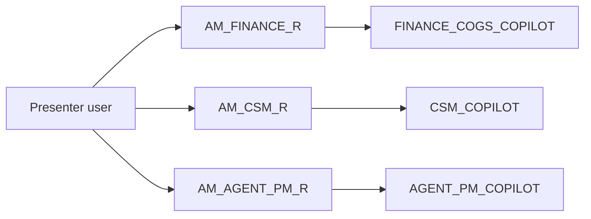

# Agent Memento: Demo Runbook

A five-minute demo script and setup steps for the presenter.

## Quick Navigation

- [Setup](#setup)
- [Demo Script](#demo-script)
- [Claude Desktop](#claude-desktop)
- [Reset](#reset)

---

## Setup



| Step | Action |
|---|---|
| 1 | Check that open proposals exist for week 2026-08-31 in `OPS.AGENT_ACTIONS` (`STATUS = 'PROPOSED'`) |
| 2 | Open two Snowsight tabs: Snowflake Intelligence and Projects → Streamlit → **Agent Memento: Agent Ops** |
| 3 | Switch roles in Snowflake Intelligence with the role picker (the persona roles are granted through `ATTENDEE_ROLE`) |

[Back to top](#quick-navigation)

---

## Demo Script

| # | Persona / surface | Say or do | Proof point |
|---|---|---|---|
| 1 | Finance, `FINANCE_COGS_COPILOT` | "Which accounts have negative gross margin, and why?" | Fabrikam −$3,062 (−11.8%) and Litware −$747 (−4.0%); price below COGS per minute; repricing target |
| 2 | Streamlit, Action Inbox, persona Finance | Open week 2026-08-31 and approve the Fabrikam proposal with a note | Supervisor drafted it autonomously; the decision lands in the audit log |
| 3 | CSM, `CSM_COPILOT` | "What is the gross margin of my accounts?", then "Show account health for my accounts" | Refuses margin (Finance only); shows only Northwind, Contoso, Wingtip |
| 4 | Agent PM, `AGENT_PM_COPILOT` | "Which model routing changes has the supervisor proposed, and what would they save?" | About $23.5 K/month from moving premium traffic to Sonnet |
| 5 | Claude Desktop over MCP | "Using finance-cogs-copilot, brief me on unit economics this month" | The same governed answer on an Anthropic surface |
| 6 | Any persona | "Show every action that was approved or rejected and who decided" | Audit trail with role, time and note |

**Closing line:** Claude drafts the answer, the agent decides with a human in the loop, and governance holds from the first query to the last action.

[Back to top](#quick-navigation)

---

## Claude Desktop

1. In Claude Desktop, add a custom connector (remote MCP server) with this URL:

   `https://<account>.snowflakecomputing.com/api/v2/databases/AGENT_MEMENTO/schemas/SEMANTIC/mcp-servers/AGENT_MEMENTO_MCP`
   - Account identifier: `SFSEHOL-ANTHROPIC_SNOWFLAKE_HACKATHON_ASDZAA`.
2. Authenticate:
   - **OAuth (preferred):** the account needs an OAuth security integration for the Claude client. Creating it needs integration privileges.
   - **PAT:** a personal access token restricted to the persona role, sent as a Bearer header if your Claude client supports custom headers.
3. Tools appear as `agent-pm-copilot`, `csm-copilot`, `finance-cogs-copilot` and `agent-ops-semantic-view`. Each runs with the token's role, so persona rules still apply.

I haven't tested this connection from Claude Desktop yet; confirm the URL format and auth options against the Snowflake managed MCP documentation before the demo.

[Back to top](#quick-navigation)

---

## Reset

Reopen the demo decision so step 2 can be repeated:

```sql
UPDATE AGENT_MEMENTO.OPS.AGENT_ACTIONS
   SET STATUS = 'PROPOSED', DECIDED_BY = NULL, DECIDED_ROLE = NULL, DECIDED_PERSONA = NULL,
       DECIDED_TS_PT = NULL, DECISION_NOTE = NULL
 WHERE AS_OF_DATE = '2026-08-31';
```

[Back to top](#quick-navigation)
