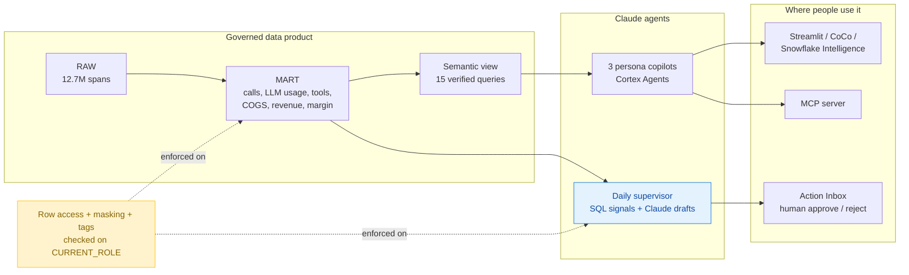

# Agent Memento: Hackathon Submission

This is the submission pack for the Anthropic x Snowflake hackathon.
- The Cerebral Valley form fields can be copied from [Submission Fields](#submission-fields).
- The 1-minute video follows [Demo Video Script](#demo-video-script).

## Quick Navigation

- [Submission Fields](#submission-fields)
- [Architecture Summary](#architecture-summary)
- [Built During the Event](#built-during-the-event)
- [Demo Video Script](#demo-video-script)
- [Pre-Submit Checklist](#pre-submit-checklist)

---

## Submission Fields

**Project name:** Agent Memento

**One-liner:** Governed Claude copilots and an autonomous supervisor that turn 12.7M voice-agent traces into margin decisions, where every answer and every action stays inside Snowflake's security boundary.

**Value case**

Voice-AI platforms pay per token and per telephony minute, but they bill customers per contract. Nobody can see which accounts, caller intents or model choices erode margin.

Agent Memento answers that from raw Braintrust traces:
- **Loss-making accounts:** Fabrikam Insurance is at -11.8% gross margin and Litware Telehealth at -4.0%.
- **Routing savings:** moving Opus traffic to Sonnet would save about $23.5K per month.
- **Supervisor proposals:** a daily supervisor proposes fixes, about $29.7K per month in the latest week, and a human approves or rejects each one in a single click.

Three personas each get their own copilot: Finance, Agent Product Manager and Customer Success. Each sees only the data their role allows.

**Architecture summary:** see [Architecture Summary](#architecture-summary).

**Build story**
1. **Data:** loaded 63 Parquet files (8.4 GB, 12.7M spans) into `RAW`, then modelled the call grain (243K calls) in `STAGING`. Built a star schema in `MART` with model cost, telephony COGS, contract revenue and margin.
2. **Semantics:** published `SEM_AGENT_OPERATIONS`, with 15 verified queries across Finance, PM, CSM and audit, so every metric has one definition.
3. **Copilots:** built 3 persona Cortex Agents, plus an ops analyst agent, all on that semantic view. They're exposed through CoCo, Streamlit and a Snowflake-managed MCP server.
4. **Autonomy:**
   - A daily task (`TSK_AGENT_SUPERVISOR`) detects 4 signal types in SQL.
   - Claude, via `AI_COMPLETE`, drafts the diagnosis and the fix. Every number in the draft comes from SQL.
   - The drafts land as proposals in an Action Inbox.
   - `PROC_DECIDE_ACTION` records the human decision and audits it.
5. **Trust by design:**
   - Row access policies for account and proposal visibility.
   - Masking for revenue, margin and PHI/PII.
   - Classification tags.
   - A validation suite (DQ01–DQ25, RL01–RL04) and persona evals (6 of 6 passing).
6. **Experience:** a Streamlit dashboard with a copilot chat that shows which agent, skill and model answered, plus the Action Inbox, overview and account scorecard.

**Viability**
- **Platform-native:**
  - No data leaves Snowflake. Claude runs through Cortex.
  - Governance is enforced by Snowflake policies, not by prompts.
  - The same rules apply in Snowflake Intelligence, CoCo, MCP clients and SQL.
- **Rebuildable:** the whole system rebuilds from the numbered scripts in [sql](../sql), so it moves to any account with a Braintrust export.
- **Safe autonomy:** the supervisor can only propose; a human decides, with an audit trail. That makes it safe to run unattended every day.
- **Next steps:** live Braintrust ingestion (Snowpipe or Openflow), acting on approved routing changes, and Snowflake Intelligence rollout by persona role.

**Public GitHub repo:** [github.com/Lathendra/agent_memento](https://github.com/Lathendra/agent_memento)

**Tools used**

| Area | Tools |
|---|---|
| AI | Claude (Opus and Sonnet) via Snowflake Cortex: Cortex Agents, Cortex Analyst, `AI_COMPLETE` |
| Snowflake | Semantic views, Snowflake-managed MCP server, Tasks, stored procedures, row access and masking policies, tags, Streamlit in Snowflake |
| Build | Cortex Code (CoCo) with Claude, Python, SQL |
| Data | Synthetic Braintrust voice-agent spans, Jul 29 to Sep 1 2026 |

[Back to top](#quick-navigation)

---

## Architecture Summary

The detailed design is in [Architecture](Architecture.md). The governance mapping is in [Trust by Design](Trust-by-Design.md).

[Back to top](#quick-navigation)

---

## Built During the Event

Everything below was created on Oct 23 2026, during the hackathon:

| Evidence | Value |
|---|---|
| `AGENT_MEMENTO` database created | 2026-10-23 11:56 PT |
| 21 tables and views created | 12:03 to 13:44 PT |
| Supervisor and decision procedures created | 13:36 to 13:38 PT |
| Repository first commit | 2026-10-23 15:38 PT |

The pre-existing hackathon sample (`STOWEAWAY.ANALYTICS`) was only used as a reference and is not part of this project.

[Back to top](#quick-navigation)

---

## Demo Video Script

The target is 60 seconds of screen recording, using Loom or QuickTime, uploaded as unlisted or public to YouTube or Loom. Show only what was built today.

| Time | Screen | Voice-over |
|---|---|---|
| 0:00–0:08 | Dashboard header, Finance persona | "Agent Memento: governed Claude copilots on 12.7 million voice-agent traces. Built today on Snowflake." |
| 0:08–0:25 | **Ask the Copilot**: click *"Which accounts have negative gross margin, and why?"* and show the answer footer (agent, skill, model) | "Finance asks in plain English. A Cortex Agent answers from our semantic view, and you can see the agent, skill, Claude model and SQL behind every answer." |
| 0:25–0:42 | **Action Inbox**: open a proposal, read "Why" and "Suggested fix", click Approve, then open the audit trail | "Every morning a supervisor task finds problems in SQL and Claude drafts the fix. A human approves, and every decision is audited." |
| 0:42–0:54 | Switch persona to **Customer Success**, then open Accounts: 3 accounts, financials hidden | "Same platform, different role. Row access and masking policies limit what each persona and each agent can see." |
| 0:54–1:00 | Overview headline banner | "Unprofitable accounts found, $23K a month in savings proposed, and everything governed inside Snowflake." |

Recording tips:
- **Before recording:** pre-run the copilot question once so the warehouse is warm, then press Clear.
- **If the answer is slow:** pause the recording while it thinks, or cut the wait in Loom.
- **Reset after any rehearsal approval:** run the reset SQL from the [Demo Runbook](Demo-Runbook.md) so the proposal shows as open again.

[Back to top](#quick-navigation)

---

## Pre-Submit Checklist

- [ ] The repo is public: [github.com/Lathendra/agent_memento](https://github.com/Lathendra/agent_memento) (verified public at 15:40 PT).
- [ ] The latest docs are pushed (`docs/Submission.md`, `docs/Trust-by-Design.md`).
- [ ] The video is recorded, at most about 60 seconds, and uploaded.
- [ ] The video link opens in a private or incognito window.
- [ ] The Cerebral Valley form is filled in from [Submission Fields](#submission-fields), with the repo and video links.
- [ ] No slide deck is attached; the video is the pitch.
- [ ] Submitted before **4:30 PM**.

[Back to top](#quick-navigation)
