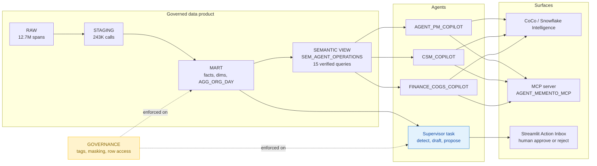
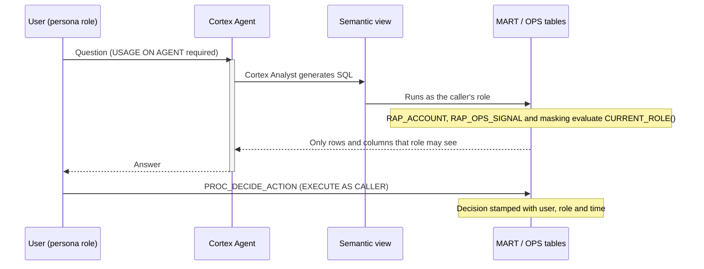

# Agent Memento: What We Built, Framed by Trust by Design

Agent Memento turns raw voice-agent traces into a governed data product. Persona copilots and an autonomous supervisor act on that data product. This document maps the build onto the two framing slides from the Snowflake x Claude session:

- the demo framing: business, goal, personas
- **Trust by Design**: "Governed from the first query to the last agent action."

## Quick Navigation

- [The Business, Goal and Personas](#the-business-goal-and-personas)
- [What We Built](#what-we-built)
- [Trust by Design Scorecard](#trust-by-design-scorecard)
- [Pillar 1: Governed by Default](#pillar-1-governed-by-default)
- [Pillar 2: Security Flows Through](#pillar-2-security-flows-through)
- [Pillar 3: Observable and Auditable](#pillar-3-observable-and-auditable)
- [Pillar 4: Cyber Defense Built In](#pillar-4-cyber-defense-built-in)
- [Headline Numbers](#headline-numbers)
- [Known Gaps](#known-gaps)

---

## The Business, Goal and Personas

The reference demo (Stoweaway, a fictional retail brokerage) frames a business, a goal and its personas. Agent Memento uses the same framing for a voice-agent platform company.

| Slide element | Stoweaway (reference demo) | Agent Memento (our build) |
|---|---|---|
| **The Business** | Retail brokerage. Customers open, fund and invest. | Voice-AI platform. Customer accounts run LLM voice agents that handle calls (scheduling, billing, triage). |
| **North star** | Retained, growing accounts | Profitable, resolved calls: high resolution rate at a positive gross margin per account |
| **The Goal** | "Retention is up. Driver unknown." | "Model spend is up. Margin driver unknown." Find which accounts, intents and models erode margin, turn that into actions, and keep every number governed. |
| **Personas** | Marketing Analyst, Data Scientist, Design Team | Agent Product Manager, Customer Success Manager, Finance (COGS) |
| **Data** | Synthetic brokerage data | 12.7M synthetic Braintrust spans, 243K calls, 35 days (Jul 29 to Sep 1 2026) |

[Back to top](#quick-navigation)

---

## What We Built

Everything runs inside the Snowflake database `AGENT_MEMENTO`.

| Layer | Objects | Purpose |
|---|---|---|
| Ingestion | `RAW` schema, 63 Parquet files (8.4 GB) | Raw span payloads, deduplicated |
| Modeling | `STAGING`, `MART` (`FCT_CALL`, `FCT_LLM_USAGE`, `FCT_TOOL_CALL`, `AGG_ORG_DAY`, 6 dimensions) | Call grain, model cost, telephony COGS, revenue, margin |
| Semantics | `SEM_AGENT_OPERATIONS` | One business definition of every metric, with 15 verified queries |
| Copilots | 3 persona Cortex Agents and `AGENT_OPS_ANALYST` | Natural-language Q&A per persona |
| Autonomy | `OPS.TSK_AGENT_SUPERVISOR` (daily 6:15 PT), `PROC_RUN_SUPERVISOR`, `PROC_DECIDE_ACTION` | Detects signals, Claude drafts the diagnosis, a human decides |
| Access | MCP server, Streamlit `AGENT_OPS_DASHBOARD_WH`, CoCo | The same agents across every surface |
| Quality | [Validation suite](../sql/90_validate.sql) with DQ01–DQ25 and RL01–RL04; 6 of 6 persona evals passed | Proves the numbers and the boundaries |

[Back to top](#quick-navigation)

---

## Trust by Design Scorecard

The slide's thesis is: "Capability and safety advance together. Never a tradeoff made later." Governance was built into the same SQL scripts as the mart, not added after the demo worked.

| Foundation (slide) | Delivers (slide) | Agent Memento implementation | Status |
|---|---|---|---|
| Governed by default | Data only used as intended | Row access, masking and classification tags on the mart and supervisor tables | Done, verified |
| Security flows through | Delegate without adding risk | Agents run with the caller's role, with one grant model from query to action | Done, verified |
| Observable and auditable | Prove what happened, every time | Run log, decision audit, eval results, validation suite | Done, verified |
| Cyber defense built in | Scale usage without scaling exposure | Claude via Cortex inside the Snowflake boundary, plus least-privilege roles | Inherited from the platform, partial |

[Back to top](#quick-navigation)

---

## Pillar 1: Governed by Default

> *Row-level security, business rules, data boundaries → right visibility for every user, inside the boundary.*

| Control | Object | Effect |
|---|---|---|
| Row access by account | `GOVERNANCE.RAP_ACCOUNT` on the mart | The CSM sees only her 3 accounts (Northwind Health, Contoso Dental Group, Wingtip Veterinary) |
| Row access on agent output | `GOVERNANCE.RAP_OPS_SIGNAL` on `OPS.AGENT_ACTIONS` and `OPS.AGENT_SIGNALS` | Margin proposals are visible to Finance only, and account proposals only to mapped roles |
| Financial masking | Masking policies on revenue, margin and contract price | `NULL` for every role except Finance |
| PHI and PII masking | Masking policies on payload, session id, email and user name | Raw caller content is never exposed to personas |
| Classification | 4 tags (sensitivity and domain) | Columns carry their data class |
| Business rules | Semantic view metrics and verified queries | Margin and COGS per minute have one definition |

Verified result (the same query run under each role):

| Role | Accounts | Revenue | Proposals |
|---|---|---|---|
| `AM_CSM_R` | 3 | `NULL` | 27 |
| `AM_AGENT_PM_R` | 8 | `NULL` | 27 |
| `AM_FINANCE_R` | 8 | $274,609 | 36 |

[Back to top](#quick-navigation)

---

## Pillar 2: Security Flows Through

> *One identity and permission model, query to agent action → agents act with the person's rights, nothing more.*

- **One grant per persona:** each persona role gets `USAGE` on exactly one copilot, plus `SELECT` on the semantic view and `USAGE` on the MCP server.
- **No privileges of its own:** the agent never holds a service identity, so the same question returns different answers per role.
- **Decisions run as the caller:** `PROC_DECIDE_ACTION` runs with the caller's rights, so a CSM cannot approve a proposal it cannot see.
- **The same rules on every surface:** the MCP server exposes the agents to external clients such as Claude Desktop under the token's user and role, so the same policies apply.

[Back to top](#quick-navigation)

---

## Pillar 3: Observable and Auditable

> *Every step traced and reviewable → audit and compliance sign off faster.*

| Evidence | Object | What it proves |
|---|---|---|
| Supervisor run log | `OPS.AGENT_RUN_LOG` | Every scheduled run, with signals found, actions proposed, status and role |
| Signals | `OPS.AGENT_SIGNALS` | The SQL evidence behind each proposal, before Claude drafts the text |
| Decision audit | `OPS.AGENT_ACTIONS` (`DECIDED_BY`, `DECIDED_ROLE`, `DECIDED_TS_PT`, `DECISION_NOTE`) | Who approved what, when and why |
| Agent quality | `OPS.AGENT_EVAL_RESULT` | Persona evals: 6 of 6 passed, including refusals outside the persona's scope |
| Data quality | [Validation suite](../sql/90_validate.sql) | Grain, reconciliation and row-access checks pass |
| Generated SQL | Copilot Chat's "Generated SQL" expander | Every agent answer shows the query behind it |

Claude writes the narrative, while every number comes from SQL. The diagnosis text can always be traced back to a signal row.

[Back to top](#quick-navigation)

---

## Pillar 4: Cyber Defense Built In

> *Frontier safeguards at the model layer → safety grows with capability, not after it.*

- **Model inside the boundary:** Claude runs through Cortex (`AI_COMPLETE`, Cortex Agents) inside Snowflake, so data does not leave the account for inference.
- **Model-layer safeguards:** these are inherited from Anthropic and Snowflake Cortex. We did not configure additional guardrails.
- **Least privilege:**
  - Persona roles have no write access to the mart.
  - The supervisor can only insert proposals; acting on them requires a human decision.
- **A propose-only agent:** the supervisor never changes pricing or routing itself. Every change goes through the Action Inbox.

[Back to top](#quick-navigation)

---

## Headline Numbers

| Metric | Value |
|---|---|
| Calls resolved | 97.0% |
| Tool error rate | 2.97% |
| Model cost | $115.5K ($0.475 per call) |
| Revenue / gross margin | $274.6K / 42.0% |
| Loss-making accounts | Fabrikam Insurance (-11.8%), Litware Telehealth (-4.0%) |
| Opus → Sonnet routing savings | About $23.5K per month |
| Supervisor proposals | 36 across 5 weekly runs, about $29.7K per month open impact in the latest week |

[Back to top](#quick-navigation)

---

## Known Gaps

| Gap | Impact | Mitigation |
|---|---|---|
| The Streamlit app runs as its owner role | The persona picker simulates RLS and masking; Snowflake does not enforce them inside the app | Show enforcement through CoCo, Snowflake Intelligence or MCP under each persona role |
| Secondary roles set to `ALL` on the shared hackathon user | A persona session can open another persona's agent, although its data stays filtered by `CURRENT_ROLE()` | Run `USE SECONDARY ROLES NONE` in demos; real users hold only their persona role |
| Snowflake Intelligence registration | Requires `ACCOUNTADMIN` | An admin runs `ALTER SNOWFLAKE INTELLIGENCE ... ADD AGENT` |
| `MCP_CLAUDE_ROLE` is not in the account access map | MCP clients using that role see 0 accounts | Map the role or grant it a persona role |
| Model-layer guardrails | Relies on platform defaults | Add Cortex guardrails if moving to production |

[Back to top](#quick-navigation)
