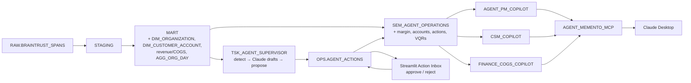
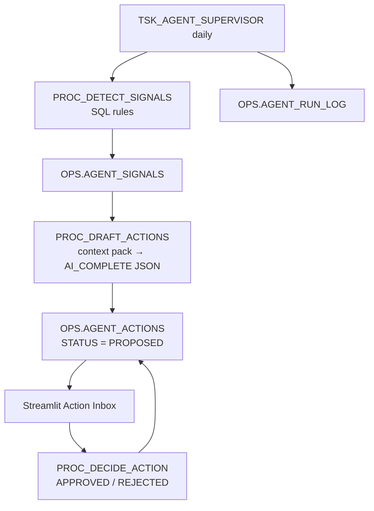

# Agent Memento Phase 2: Persona Copilots, Autonomous Supervisor, Trust Layer

Design spec, approved 2026-10-23. Phase 1 (mart, semantic view, agent, MCP, dashboard) is described in [Architecture](../../Architecture.md).

## Quick Navigation

- [Problem](#problem)
- [Architecture](#architecture)
- [Data Model](#data-model)
- [Trust](#trust)
- [Autonomy](#autonomy)
- [Surfaces](#surfaces)
- [Testing](#testing)
- [Demo Script](#demo-script)
- [Out of Scope](#out-of-scope)

---

## Problem

Voice-agent cost is rising and quality varies by customer. Find where the business loses money and quality, decide what to change, and prove every number is governed.

| Judging theme | Delivered by |
|---|---|
| Autonomy unlocks value | Daily supervisor detects, diagnoses and proposes actions, and logs everything; humans decide |
| Context × Claude | Governed semantic view and verified queries (VQRs), reached through 3 persona copilots in Snowflake Intelligence and in Claude Desktop over MCP |
| Trust by design | Masking, row access by account, financial masking, persona roles, audited decision log, guardrails |

[Back to top](#quick-navigation)

---

## Architecture

[Back to top](#quick-navigation)

---

## Data Model

| Object | Grain / key | Notes |
|---|---|---|
| `MART.DIM_ORGANIZATION` | `ORG_ID` | From real `RAW.ORG_ID` / `PROJECT_ID` (1 org, 1 project) |
| `MART.DIM_CUSTOMER_ACCOUNT` | `ACCOUNT_ID` (8 rows) | Seeded, synthetic. Columns: `ORG_ID`, `ACCOUNT_NAME`, `SEGMENT`, `INDUSTRY`, `CSM_OWNER`, `PLAN_TIER`, `CONTRACT_PRICE_PER_MIN_AMOUNT`, `CONTRACT_START_DATE`, `BUCKET_LO`, `BUCKET_HI` |
| `MART.DIM_COST_RATE` | 1 row | `TELEPHONY_COST_PER_MIN_AMOUNT = 0.0085` (assumed), editable |
| `MART.FCT_CALL` | `CALL_HASH` (unchanged) | Adds `ORG_ID`, `ACCOUNT_ID`, `BILLABLE_MINUTES`, `REVENUE_AMOUNT`, `TELEPHONY_COST_AMOUNT`, `COGS_AMOUNT`, `GROSS_MARGIN_AMOUNT` |
| `MART.FCT_LLM_USAGE`, `MART.FCT_TOOL_CALL` | Unchanged | Add `ACCOUNT_ID` for row access |
| `MART.AGG_ORG_DAY` | Date × account × intent × outcome × model | Additive measures only; replaces `AGG_CALL_DAY` |

**Rules:**

- **Account assignment:** a deterministic weighted bucket on `MOD(ABS(HASH(CALL_HASH)), 100)` (`MART.FN_ACCOUNT_BUCKET`), against cumulative volume shares `BUCKET_LO` / `BUCKET_HI`.
- **Billable minutes** = `CEIL(DURATION_SECONDS / 60)`.
- **Revenue** = billable minutes × `CONTRACT_PRICE_PER_MIN_AMOUNT`. Prices are set so that at least 2 accounts have negative margin.
- **COGS** = LLM cost from `FCT_LLM_USAGE` + billable minutes × telephony rate.
- **Gross margin** = revenue − COGS.

[Back to top](#quick-navigation)

---

## Trust

| Persona | Role | Agent | Rows | Financial columns |
|---|---|---|---|---|
| Agent Product Manager | `AM_AGENT_PM_R` | `AGENT_PM_COPILOT` | All | Masked |
| Customer Success Manager | `AM_CSM_R` | `CSM_COPILOT` | Own book via `GOVERNANCE.ACCOUNT_ACCESS_MAP` | Masked |
| Finance (COGS) | `AM_FINANCE_R` | `FINANCE_COGS_COPILOT` | All | Clear |

- `GOVERNANCE.RAP_ACCOUNT` is a row access policy on `ACCOUNT_ID`, applied to `FCT_CALL`, `FCT_LLM_USAGE`, `FCT_TOOL_CALL` and `AGG_ORG_DAY`.
  - `ATTENDEE_ROLE`, `AM_AGENT_PM_R` and `AM_FINANCE_R` see all rows.
  - Any other role sees only the accounts mapped to it in `ACCOUNT_ACCESS_MAP` (role → account).
- `GOVERNANCE.MP_FINANCIAL` masks `REVENUE_AMOUNT`, `GROSS_MARGIN_AMOUNT` and `CONTRACT_PRICE_PER_MIN_AMOUNT`. Values are clear only to `ATTENDEE_ROLE` and `AM_FINANCE_R`.
- **Existing controls kept:** PHI/PII masking, tags, and a MART that holds hashes only.
- **Agents run with the caller's role.** The same question MUST return different results for CSM and Finance.
- **Guardrails:**
  - Agents: answer-only instructions, a budget of 60 s and 32K tokens, and no write tools.
  - Supervisor: the prompt contains aggregates only (no PHI), and responses must match a strict JSON schema.
- All three roles are granted to the single demo user, who switches roles during the demo.

[Back to top](#quick-navigation)

---

## Autonomy

All signal rules use the 7-day window ending `P_AS_OF_DATE`.

| Signal | Rule | Owner |
|---|---|---|
| `NEGATIVE_MARGIN_ACCOUNT` | Account gross margin < 0 | Finance |
| `MODEL_COST_SHIFT` | Opus-mapped model > 40% of an intent's LLM cost and savings ≥ $100 per month; savings = that cost re-priced at Sonnet | Agent PM, Finance |
| `ANOMALY_SPIKE` | Account anomaly rate > 1.5× the prior 7-day rate and > 1.2× the platform change; otherwise one platform-level signal | CSM |
| `FAILURE_SPIKE` | Account failure rate > 1.3× the prior 7-day rate and > 1.2× the platform change | Agent PM, CSM |

| Table | Key | Columns |
|---|---|---|
| `OPS.AGENT_SIGNALS` | `SIGNAL_KEY` = type + entity + as-of date | `SIGNAL_TYPE`, `ENTITY_TYPE`, `ENTITY_ID`, `AS_OF_DATE`, `METRIC_VALUE`, `BASELINE_VALUE`, `IMPACT_AMOUNT`, `OWNER_PERSONA`, `EVIDENCE` (aggregates only) |
| `OPS.AGENT_ACTIONS` | `ACTION_ID`, unique `SIGNAL_KEY` | `TITLE`, `DIAGNOSIS_TEXT`, `RECOMMENDATION_TEXT`, `PROJECTED_SAVINGS_AMOUNT` (SQL), `AI_MODEL`, `DRAFT_STATUS` (`AI_DRAFTED` or `AI_FAILED`), `STATUS` (`PROPOSED`, `APPROVED`, `REJECTED`), `DECIDED_BY`, `DECIDED_ROLE`, `DECIDED_TS_PT`, `DECISION_NOTE` |
| `OPS.AGENT_RUN_LOG` | `RUN_ID` | `PROC_NAME`, `AS_OF_DATE`, `STARTED_TS_PT`, `ENDED_TS_PT`, `SIGNAL_COUNT`, `ACTION_COUNT`, `STATUS`, `ERROR_MESSAGE` |

**Rules:**

- **Numbers MUST come from SQL.** The LLM writes only the title, diagnosis and recommendation.
- **Idempotent:** a rerun for the same `P_AS_OF_DATE` adds 0 signals and 0 actions.
- **Model:** `claude-sonnet-4-5` via `AI_COMPLETE` with a structured response format.
- **Backfill:** the job runs once for each Monday in the data range.
- **Semantic view:** gains an `actions` logical table.

[Back to top](#quick-navigation)

---

## Surfaces

| Surface | Delivery |
|---|---|
| Snowflake Intelligence | 3 persona agents with display names, sample questions and persona instructions, plus VQRs in the semantic view |
| Claude Desktop | `AGENT_MEMENTO_MCP` exposes the 3 agents and the semantic view; client setup is in [Demo Runbook](../../Demo-Runbook.md) |
| Streamlit `AGENT_OPS_DASHBOARD` | Tabs: Overview, Accounts, Action Inbox (approve/reject through `PROC_DECIDE_ACTION`). The app runs as its owner role, so row access is not applied per viewer |

[Back to top](#quick-navigation)

---

## Testing

| Area | Check |
|---|---|
| Reconciliation | Revenue = minutes × price; COGS = model + telephony; margin = revenue − COGS; `AGG_ORG_DAY` sums = `FCT_CALL` |
| Accounts | Every call has exactly one `ACCOUNT_ID`; 8 accounts; ≥ 2 negative-margin accounts |
| Row access | `AM_CSM_R` sees only mapped accounts; PM and Finance see 243,036 calls |
| Masking | CSM and PM see revenue masked; Finance sees values |
| Supervisor | A rerun adds 0 rows; every action links to a signal |
| Agents | Persona questions through `DATA_AGENT_RUN`; numbers match SQL; results in `OPS.AGENT_EVAL_RESULT` |

Existing checks DQ01–DQ12 MUST still pass.

[Back to top](#quick-navigation)

---

## Demo Script

1. **Finance copilot:** ask "Which accounts lose money and why?"; it names the negative-margin accounts and their drivers.
2. **Action Inbox:** open the model-routing proposal with projected savings. Finance approves it, and the audit row appears.
3. **CSM copilot:** the same question returns only the CSM's book, with revenue masked.
4. **Claude Desktop over MCP:** ask "Brief me on agent health this week."
5. **Audit:** ask "Show every action proposed and who decided it."

[Back to top](#quick-navigation)

---

## Out of Scope

New data sources, the reference brokerage dataset, Claude Code, Cortex Search, and incremental loads.

[Back to top](#quick-navigation)
